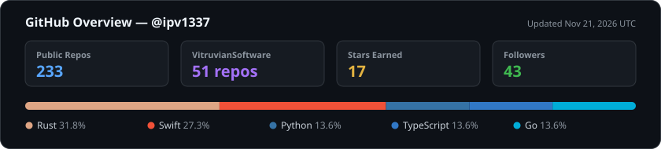

# 👋 Hello, I'm James H. Nguyen

🚀 Empowering teams with scalable cloud platforms, autonomous AI agent systems, and developer tooling.

  

## 👨‍💻 Head of Platform Engineering & Agents

> Architecting cloud platforms and AI agent workflows that help engineering teams ship faster and more reliably.

### 🛠️ Technologies & Tools

### 🌟 About Me

I'm a **Head of Platform Engineering & Agents** focused on cloud architecture, infrastructure as code, AI agent orchestration, and developer productivity. My open-source work lives under [**VitruvianSoftware**](https://github.com/VitruvianSoftware).

- 🤖 Building AI agent tooling, MCP servers, and native developer apps under [VitruvianSoftware](https://github.com/VitruvianSoftware)
- ☁️ Deep background in Google Cloud foundations, Terraform/Pulumi IaC, Kubernetes, and multi-region platform engineering
- ✍️ Writing about agentic coding, virtual engineering orgs, and systems architecture at [ipv1337.dev/blog](https://ipv1337.dev/blog/)
- 📍 Based in Irvine, CA

### 🔥 Featured Open Source Projects ([VitruvianSoftware](https://github.com/VitruvianSoftware))

<!-- VITRUVIAN-REPOS:START -->
| Project | Language | Description |
|---------|----------|-------------|
| [**VitruvianSoftware/vitruvian-code**](https://github.com/VitruvianSoftware/vitruvian-code) | `Swift` | Vitruvian Code: a macOS menu bar app and Telegram bot that connects your messages to local AI coding tools. |
| [**VitruvianSoftware/vitruvian-devx**](https://github.com/VitruvianSoftware/vitruvian-devx) | `Go` | Supercharged local dev environment |
| [**VitruvianSoftware/vitruvian-core**](https://github.com/VitruvianSoftware/vitruvian-core) | `JavaScript` | Vitruvian Software Monorepo |
| [**VitruvianSoftware/vitruvian-atrium**](https://github.com/VitruvianSoftware/vitruvian-atrium) | `Swift` | Vitruvian Atrium: a macOS menu bar utility hub. GPL-3.0 fork of vorssaint-utils, not an official Vorssaint build |
| [**VitruvianSoftware/vitruvian-courier**](https://github.com/VitruvianSoftware/vitruvian-courier) | `Swift` | Vitruvian Courier: every chat app in one inbox, as a native macOS app |
| [**VitruvianSoftware/vitruvian-orchestrator-opencode**](https://github.com/VitruvianSoftware/vitruvian-orchestrator-opencode) | `JavaScript` | OpenCode plugin: a lead agent plans the work, specialist agents do it, and a live sidebar shows the plan, the board and the spend |
<!-- VITRUVIAN-REPOS:END -->

### ✨ Notable Open Source Contributions

- [argoproj-labs/argocd-image-updater](https://github.com/argoproj-labs/argocd-image-updater) — Fixed host key verification for secret-based SSH write-back ([#1816](https://github.com/argoproj-labs/argocd-image-updater/pull/1816))
- [VitruvianSoftware/pulumi_go-example-foundation](https://github.com/VitruvianSoftware/pulumi_go-example-foundation) — Production-ready Pulumi Go implementation of the Google Cloud Enterprise Foundations Blueprint
- [terraform-google-modules/terraform-example-foundation](https://github.com/terraform-google-modules/terraform-example-foundation) — Fixed Cloud Build plan service account handling in `1-org` ([#629](https://github.com/terraform-google-modules/terraform-example-foundation/pull/629))
- [terraform-google-modules/terraform-google-composer](https://github.com/terraform-google-modules/terraform-google-composer) — Fixed module usage parameters, lint tests, and generated docs ([#4](https://github.com/terraform-google-modules/terraform-google-composer/pull/4), [#7](https://github.com/terraform-google-modules/terraform-google-composer/pull/7))
- [terraform-google-modules/terraform-google-secret](https://github.com/terraform-google-modules/terraform-google-secret) — Documentation improvements ([#25](https://github.com/terraform-google-modules/terraform-google-secret/pull/25))
- [BlueCentre/adk-agents](https://github.com/BlueCentre/adk-agents) — Intelligent DevOps agents built on Google's Agent Development Kit (ADK)

### ✍️ Latest Blog Posts ([ipv1337.dev](https://ipv1337.dev/blog/))

<!-- BLOG-POSTS:START -->
- [Hybrid Project-Scoped AI Bots with OpenClaw](https://ipv1337.dev/blog/posts/hybrid-project-bots.html) — _2026-02-27_
- [Making It Stick — Teaching Your AI Workflow to Self-Organize](https://ipv1337.dev/blog/posts/virtual-eng-org-part-4.html) — _2026-02-26_
- [Agentic Coding: Why the Next Productivity Leap Is About Collaboration, Not Autocomplete](https://ipv1337.dev/blog/posts/agentic-coding.html) — _2026-02-25_
- [The Orchestration Skill — Automating the Workflow](https://ipv1337.dev/blog/posts/virtual-eng-org-part-3.html) — _2026-02-07_
- [Giving Each Agent a Desk — Persistent Identities](https://ipv1337.dev/blog/posts/virtual-eng-org-part-2.html) — _2026-02-07_
<!-- BLOG-POSTS:END -->

### 📫 Connect With Me

